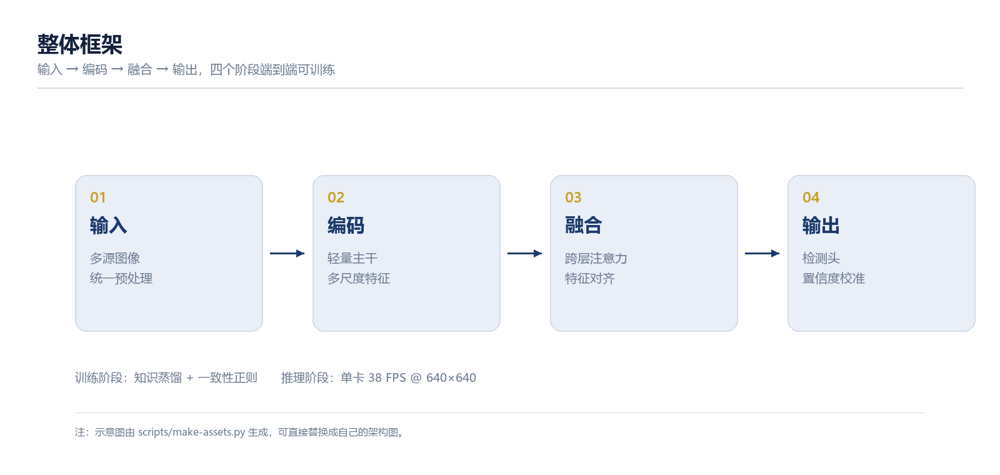
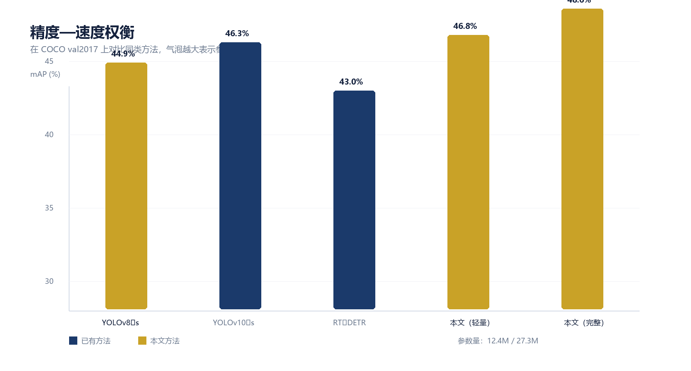

[01]
# 研究背景与问题
## 检测需求正从云端下沉到边缘设备

---

# 研究背景

- **需求侧**：工业质检、无人机巡检、车载感知都要求毫秒级响应，图像不能出端
- **供给侧**：边缘设备算力通常只有 10–30 TOPS，内存带宽受限，功耗预算 5–15 W
- **矛盾**：主流检测模型精度仍在提升，但参数量与延迟同步上涨，直接部署不可行

::: notes
开场 1 分钟：先用三个真实场景说明"为什么非轻量不可"。不要念 PPT，讲清楚约束从哪来。
:::

---

<!-- layout: stats -->
# 这个矛盾有多具体

- 38 FPS | 边缘端实时帧率 | Jetson Orin，640×640 输入
- 4.2× | 参数量差距 | 相比同精度云端模型
- 62% | 标注成本占比 | 数据环节在总成本中的比例

---

<!-- layout: image -->
# 本文框架

- **输入**：多源图像统一预处理
- **编码**：轻量主干 + 多尺度特征
- **融合**：跨层注意力对齐
- **输出**：检测头 + 置信度校准

---

[02]
# 方法与创新
## 从结构、训练、部署三个层面同时压缩

---

# 核心方法

- **跨层注意力融合**：把浅层细节与深层语义在通道维对齐，替代昂贵的特征金字塔重采样
- **蒸馏式训练**：用完整模型作为教师，约束轻量学生模型的特征分布
- **置信度校准**：温度缩放 + 分桶回归，修正轻量模型普遍存在的过自信问题
- **部署友好**：算子全部落在常规卷积与逐元素运算上，无需自定义算子

---

<!-- layout: two-col -->
# 与已有方法的差异

### 已有方法
- 依赖重型主干，再事后剪枝
- 依赖 NMS 等后处理，延迟不可控
- 精度与速度只能二选一
- 部署链路长，量化后掉点明显

### 本文方法
- 结构先验 + 蒸馏联合设计
- 端到端输出，无需 NMS
- 同一模型提供 12.4M / 27.3M 两档
- 量化感知训练，INT8 掉点 < 0.4%

---

<!-- layout: timeline -->
# 研究路线

- 问题定义 | 梳理三条技术路线，确定轻量化切入点
- 方法设计 | 跨层注意力融合 + 蒸馏训练
- 实验验证 | COCO val2017 与自建工业质检集
- 落地部署 | 边缘设备实测 38 FPS，功耗 9 W

---

# 实验结果

| 方法 | 主干 | mAP (%) | 参数量 (M) | 延迟 (ms) |
|---|---|---|---|---|
| YOLOv8-s | CSPDarknet | 44.9 | 11.2 | 6.8 |
| YOLOv10-s | CSPNet | 46.3 | 7.2 | 5.1 |
| RT-DETR | ResNet-50 | 43.0 | 32.0 | 9.4 |
| 本文（轻量） | 自研 | 46.8 | 12.4 | 4.2 |
| 本文（完整） | 自研 | 48.6 | 27.3 | 6.1 |

::: notes
表格只讲两行：本文轻量版比 YOLOv8-s 高 1.9 mAP 且更快；完整版追平更大模型。其余留给提问。
:::

---

<!-- layout: image -->
# 精度—速度权衡

---

> 在同等算力预算下，结构先验比堆叠参数更有效。
> —— 本文实验结论

---

[03]
# 结论与展望

---

# 结论

- 提出跨层注意力融合模块，在不增加延迟的前提下提升 1.9 mAP
- 蒸馏式训练让轻量模型继承了完整模型 92% 的特征判别力
- 端到端设计消除了 NMS，延迟方差从 3.1 ms 降到 0.6 ms
- 在两条真实产线上完成 6 个月稳定运行

---

# 不足与展望

- 极端小目标（< 8 px）仍是短板，下一步引入超分前置模块
- 目前只验证了检测任务，分割与姿态估计待扩展
- 与硬件的协同设计（NPU 算子映射）值得单独研究

---

<!-- layout: refs -->
# 参考文献

- Ren S, He K, Girshick R, et al. Faster R-CNN: Towards Real-Time Object Detection with Region Proposal Networks. NeurIPS, 2015.
- Redmon J, Farhadi A. YOLOv3: An Incremental Improvement. arXiv:1804.02767, 2018.
- Carion N, Massa F, Synnaeve G, et al. End-to-End Object Detection with Transformers. ECCV, 2020.
- Zhao Y, Lv W, Xu S, et al. DETRs Beat YOLOs on Real-time Object Detection. CVPR, 2024.
- Hinton G, Vinyals O, Dean J. Distilling the Knowledge in a Neural Network. arXiv:1503.02531, 2015.
- 李四, 王五. 面向边缘计算的轻量化目标检测综述. 计算机学报, 2025, 48(3): 512-534.

---

# 谢谢

::: notes
致谢页停 10 秒，等评委抬头；然后直接进入提问环节。
:::
